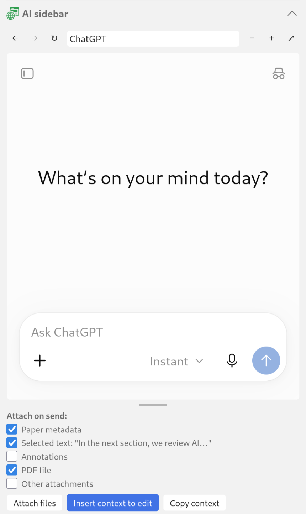
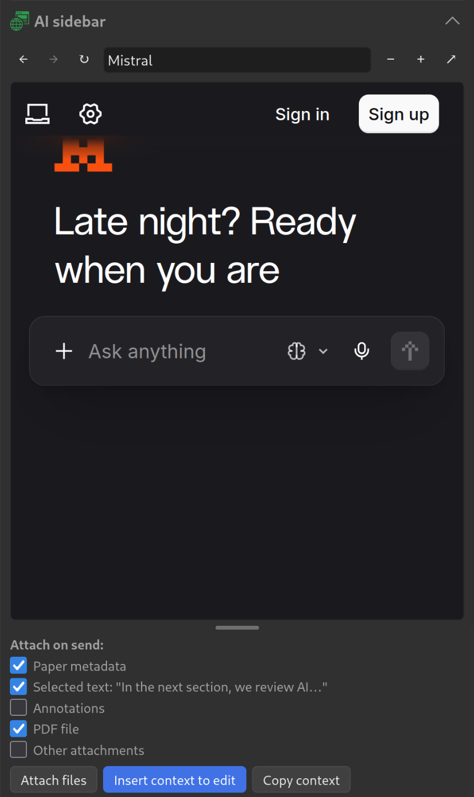

# Side Browser

<p align="center">
  
  
</p>

Existing AI chatting addons for Zotero reequire an API key or a subscription. Not this.

With this addon, you can use any web chat, perfectly integrated with zotero items, metadata,
annotations, selections, and file attachments.

Open any chat page next to your library, and send paper context to it with
one click.

_*Why?*_

As of now, you don't really need to spend money to chat with your PDF and Zotero library. Stop
paying the Big Techs.

### Free services powered by climate-aware energy

- Euria
- Ecosia AI
- Mistral Le Chat

### Free services with privacy-respecting policies

- Lumo
- Euria
- Duck.ai
- Brave Leo
- Venice
- Ecosia AI

### Free services with opt-out from data re-use for training

- ChatGPT
- DeepSeek
- Mistral Le Chat
- Claude
- Gemini
- Perplexity

## Features

- No API key and no subscription. You use the free web chats you already have an
  account for, and the site's own limits apply.
- One pane in Zotero's right column, with its own icon in the strip next to Info,
  Abstract, and Tags. It follows the light and dark theme.
- Eleven services ready to use: ChatGPT, Claude, DeepSeek, Mistral Le Chat,
  Gemini, Euria, Ecosia AI, Lumo, Duck.ai, Brave Leo, and Venice, plus
  any other chat page through a custom URL.
- Your papers go with your message. You type in the chat page as usual, and the
  plugin attaches the files when you press send.
- Five choices of what to attach: paper metadata, the text you selected, your
  annotations, the PDF, and other attachments such as an EPUB.
- Real files, not pasted text. The chat sees the real PDF with its figures, and
  your message box stays clean.
- Attaching uses the site's own attach button and file input, then a drop on the
  message box, so it works even where a site builds its input on demand.
- Works in the library and in the reader. Select text in a PDF, click "Ask about
  this", and the selection travels with your next message.
- Works on many papers at once. Select several, click the icon in the strip, and
  ask about all of them.
- Edit before you send. "Edit context" shows the text in a box, and "Copy context"
  puts it on the clipboard.
- Tall by default and resizable, with a drag bar under the page, and zoom out and
  zoom in buttons that remember your choice.
- Remembers where you were. Your login stays, and a new tab reopens the last
  address you visited, which is usually your last conversation.
- Quiet. Nothing is reported when all goes well, and a problem opens one dialog.

## What the pane sends

Under the page, the list "Attach on send" has five check boxes. Each one adds
files:

- Paper metadata: a small Markdown file with the title, authors, venue, DOI, and
  abstract of each paper.
- Selected text: a Markdown file with the text you selected in the reader.
- Annotations: a Markdown file with the highlights and comments of the PDF, plus
  the picture of each image annotation.
- PDF file: the real PDF of each paper.
- Other attachments: the other attachments of the paper that exist as local
  files, such as an EPUB or a Word file. Each one must be under 30 MB.

Each file changes shape to suit the page, because the sites do not take the same
kinds of file:

- A text file first goes as Markdown, then as plain text.
- A page that takes documents but no text gets the text as a small PDF.
- A page that takes pictures only, such as Brave Leo or Euria, gets the text as a
  picture of it.
- A page that takes no PDFs, such as Duck.ai with a text file, gets the words of
  the PDF instead.

So the same paper reaches a chat that reads documents, one that reads pictures,
and one that reads only text.

Three buttons sit under the list:

- Attach files attaches the checked files now, so the site uploads them early.
  They do not go out a second time with your next message.
- Edit context shows the context text in a box, to read and change it. Your
  changes go in front of your next message. Press the button again to hide the
  box.
- Copy context puts the same text on the clipboard.

When you press the page's send button, or Enter in its message box, the plugin
stops that send, attaches the checked files, waits for the upload, and sends your
message. The files travel once for each choice of papers and boxes. Pick another
paper, or change a box, and the next message carries the new files.

## Browser controls

The toolbar has back, forward, reload, the service list, zoom out, zoom in, and a
button that opens the page in your system browser. Drag the bar under the page to
change its height, and double-click the bar to fill the window again.

## Marks next to each service

The service list shows a mark next to each name, taken from the three lists at the
top of this page:

- A present in gold: free to use. Every service here has it.
- A mask in teal: a privacy-respecting policy.
- A leaf in green: powered by climate-aware energy.

Hover a mark to read what it means. The three colours are chosen to stay legible
on both the light and the dark Zotero theme.

## Adding a service

`Zotero.SideBrowser.probe()` in the error console describes the page in the open
pane: its message boxes, the buttons around them, and its file inputs. Copy the
selectors into an entry in `src/providers/registry.mjs`.

## Install

1. Build the XPI: `scripts/build.sh`. Add `--with-tests` to keep the self-test
   modules.
2. In Zotero, open Tools, then Plugins, then the gear menu, and choose Install
   Plugin From File.
3. Pick `dist/sidebrowser.xpi`.

Zotero accepts the plugin without signature only when
`xpinstall.signatures.required` is `false`, which is the default in Zotero's own
build. A distributed copy would need signing.

## Development

- `src/core.mjs` wires the plugin: resource alias, window actor, per-window
  sidebar, and the console API.
- `src/section.mjs` registers the item pane section and drives each pane.
- `src/multi.mjs` adds the icon and the pane for the no-item and many-item views.
- `src/scope.mjs` decides which papers are the context and builds the block.
- `src/actors/ai-child.mjs` is the only file that runs inside the chat page.
- `src/context.mjs` turns Zotero items into prompts and file lists.
- `src/providers/registry.mjs` holds the per-site selectors.
- `DESIGN.md` records the measured Zotero behaviour the code depends on.

`Zotero.SideBrowser` in the error console offers `open()`, `reload()`, `panes()`,
`ask(text)`, and `selfTest()`. The self test
seeds one sample paper, checks the context helpers, drives a local mock page
through a full send with a PDF attached, and opens the reader to check the
selection path.

### Releases and auto-update

Tag a commit as `v0.1.0` and push the tag. The workflow in
`.github/workflows/release.yml` checks that `manifest.json` matches the tag,
builds the XPI, writes `update.json` with the XPI hash, and publishes both to a
GitHub release. It also refreshes the rolling `release` release, which holds only
the newest `update.json`. Zotero polls the URL in the plugin manifest, so that
rolling release is what delivers updates.

To check the pieces by hand:

```sh
./scripts/build.sh
node scripts/update-manifest.mjs --tag v0.1.0 --repo 00sapo/zotero-sidebrowser --out dist/update.json
```

